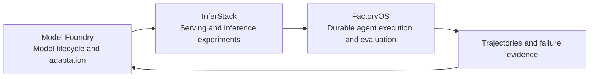

# Sanjay Kumar

**Engineering leader building AI systems and scalable platforms.**

Former Head of Engineering at Drive lah. I have 10+ years of software engineering experience and have led a team of 12–15 engineers across marketplace platforms serving Singapore and Australia.

My work combines technical strategy and hands-on architecture with hiring, performance reviews, promotions, product roadmap decisions and infrastructure budget ownership.

[Portfolio](https://sanjox.tech) · [LinkedIn](https://www.linkedin.com/in/sanjoxtech/) · [Email](mailto:sanjox.tech@gmail.com)

## What I am building

A connected AI systems program: build and adapt models, serve them efficiently, run useful tasks, and use measured failures to guide the next improvement.

| Project | Engineering focus | Current scope |
| --- | --- | --- |
| **[FactoryOS](https://github.com/sanjoxtech/factoryos)** | Durable work graphs, worker leases, independent verification, isolated execution and repeated harness evaluations | Private development; implemented runtime and evaluation workflows, with further synthesis and external qualification in progress |
| **[InferStack](https://github.com/sanjoxtech/inferstack)** | Model serving, batching and caching, inference experiments, evidence-based acceptance and release lifecycle | Private development; native runtime and optimization candidates with scoped GPU qualification |
| **[Model Foundry](https://github.com/sanjoxtech/model-foundry)** | Model inspection, immutable registry and lineage, benchmark controls and adaptation/post-training recipes | Private development; lifecycle and backend integration work, with model-quality results evaluated separately |

These source repositories are currently private. The diagram describes the architecture and development direction; it is not a claim that every end-to-end improvement loop is production-qualified.

## Engineering leadership

At Drive lah and Drive mate, my work spanned:

- Marketplace systems, payments, integrations and operational workflows across two markets.
- A staged Trip Management System transformation using domain services, gRPC contracts, Kafka and transactional outbox patterns.
- AWS infrastructure, Terraform, CI/CD, observability and cloud cost management.
- AI-assisted support, sales, verification and collections, with tools, state and human escalation.
- Engineering automation connecting tickets, coding agents and reviewable pull requests.

Company source code and confidential operational details remain private.

## Public work

- **[penprint](https://github.com/sanjoxtech/penprint)** — deterministic text-style checks for writing workflows.
- **[sanjox.tech](https://sanjox.tech)** — my portfolio and project background.

## Technical interests

Agent reliability and evaluation · inference performance and measurement · model adaptation · distributed systems · developer tooling.

I value small reproducible experiments, explicit failure handling and clear evidence about what works. My open-source contribution focus is durable agent execution, inference benchmarking and model-training tooling; contributions will be linked here as they land.

## Work with me

Based in Delhi, India. Exploring **Head of Engineering and Director of Engineering** opportunities where I can combine team leadership with hands-on AI and platform engineering.

**Python · TypeScript · Node.js · AWS · PostgreSQL · Redis · Kafka · Docker · Terraform**
